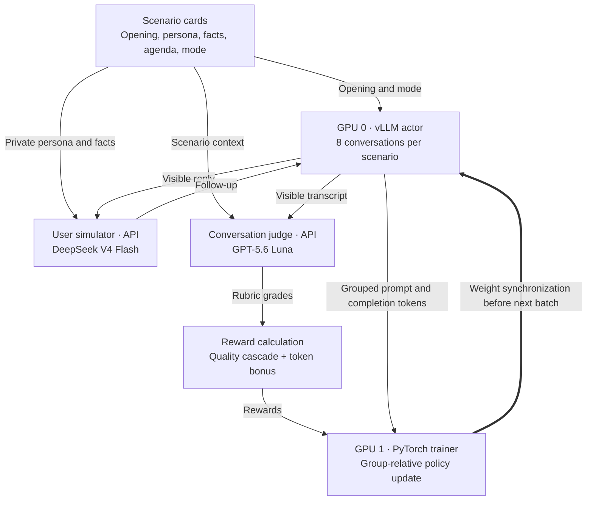

# Med Advisor 4B · RL training

- Conversation-level reinforcement learning for [Med Advisor Conversation 4B](https://huggingface.co/vmal/med-advisor-conversation-4B), starting from a supervised fine-tuned Qwen3-4B checkpoint.
- For each scenario, the policy generates eight conversations with a simulated user. A judge scores the conversations, and the trainer reinforces better-scoring outcomes relative to their group.
- The goal is better explanations, follow-ups, uncertainty handling, and clinical boundaries across an evolving conversation.

## Architecture



- **Actor:** serves the current policy and generates multi-turn conversations on GPU 0.
- **Trainer:** updates all policy weights on GPU 1, using FP32 parameters and BF16 compute.
- **Synchronous updates:** collect a batch, accumulate gradients, take one optimizer step, then broadcast weights through NCCL. The actor waits before starting the next batch.
- **Within-batch overlap:** training can process completed groups while other conversations are still running; weights stay fixed until the batch boundary.
- **Separate information:** the user and judge see visible replies. The trainer also receives generated reasoning tokens, which participate in the policy update.

## Simulated environment

- Each scenario defines an opening, persona, volunteered facts, withheld facts, follow-up agenda, turn limit, and thinking-mode flag. See [scenario loading and simulator instructions](common.py).
- Withheld facts are disclosed only when asked. Planned follow-up questions belong in the persona's agenda, so the user can ask them naturally.
- The policy sees its system message and visible conversation, rather than the private card or reference answers.
- Policy sampling uses temperature **1.0**; the user simulator uses **0.0**. Different assistant replies still produce different user follow-ups.
- Eight conversations share a starting scenario but can take different paths. The judge scores the whole conversation because later turns are no longer directly interchangeable.
- Conversations stop when the user signals completion, the turn limit is reached, or generation fails. Each policy reply allows up to **8,192 tokens**, including reasoning, within a **32,768-token context**.

## Rubrics and reward

- **Correctness — 50%:** medical accuracy, medication/numerical integrity, evidence integrity, and safety boundaries.
- **Conversation — 40%:** uncertainty calibration, question fulfillment, completeness, audience adaptation, follow-up quality, and coherence.
- **Presentation — 10%:** answer format.
- Grades **A/B/C/D/E** map to **1.0/0.85/0.60/0.25/0.0**. Permitted NA grades are excluded from family averages. Full definitions are in [description.py](description.py).
- Each response is judged against information disclosed by that point. Later revelations should not retroactively invalidate earlier answers.

With correctness `C`, conversation quality `E`, presentation `P`, and total generated assistant tokens `T`:

```text
quality = 0.50 × C + 0.40 × C × E + 0.10 × C × E × P
reward  = quality × (1 + min(0.015, 10 / T))
```

- **Correctness first:** weaker correctness reduces the contribution from conversation and presentation. This discourages easy style gains from compensating for poor substance; it does not enforce a hard-to-easy learning curriculum.
- **Small efficiency incentive:** the token bonus counts reasoning and answers, adds at most **1.5% of quality**, and encourages shorter successful conversations. Zero quality earns no bonus.
- **Failure handling:** policy truncation receives **−1**; invalid judge results are excluded. See [reward.py](reward.py).
- **Limitation:** a family average can soften an individual E grade. Judge inconsistency and incorrect NA decisions can also affect rewards; reward is not clinical ground truth.

## Policy update

```text
advantage = trajectory_reward − mean_reward_of_eligible_group_members
```

- **Dr. GRPO-inspired centering:** omit reward-standard-deviation division, avoiding amplification of tiny within-group differences that may be judge noise. See [Dr. GRPO](https://arxiv.org/abs/2503.20783).
- **DAPO-inspired token aggregation:** sum advantage-weighted assistant-token losses, normalize by total eligible tokens within each scenario group, then average across usable groups. Longer completions contribute more tokens within a group. See [DAPO](https://arxiv.org/abs/2503.14476).
- **Whole-conversation credit:** one advantage applies to all assistant turns and reasoning tokens. User tokens provide context but receive no policy loss.
- **Skip unusable groups:** require at least two eligible trajectories and reward standard deviation above `1e-6`; rescale gradients when groups are skipped.
- **Current objective:** unclipped log-probability policy gradient, one use of each batch, and zero KL penalty. Rollout/trainer probability ratios are diagnostic only. This is a custom combination of ideas, not a complete reproduction of either published algorithm.

## Configuration and running

- The included [config.yaml](config.yaml) describes an **18-step canary**, with eight groups per update: up to **64 trajectories** per batch.
- **Replace the scenario input before training:** all 48 bundled [canary cards](data/canary.jsonl) are marked `dataset_split: validation`, `evaluation_only: true`, and `training_use_forbidden: true`. The loader does not enforce these flags. Set `scenarios.files` to a training split and keep validation cards out of optimization.
- Cards currently contain 24 thinking and 24 non-thinking flags. Per-card flags take precedence; `scenarios.thinking` is only a fallback.
- The canary uses AdamW, peak learning rate **5e-7**, **3 warm-up steps**, cosine decay toward **20%** of peak, no weight decay, and gradient clipping at **1.0**. These are canary settings, not the full RL100 experiment configuration.
- Use a Linux CUDA/PyTorch environment with **two GPUs**, compatible vLLM dependencies, and sufficient memory for full-model training. Set policy/tokenizer paths in the config; the default is `/workspace/sft`.
- Set `DEEPSEEK_API_KEY` and `OPENAI_API_KEY`, and verify access to the configured simulator and judge models. Simulation and judging make paid API calls.

From this directory, after updating the configuration:

```bash
python -m pip install -r requirements.txt
python -u run.py --config config.yaml
```

- Outputs go to `run.out_dir`: `groups_*.jsonl` stores conversations and judgments, `train_metrics.jsonl` records training statistics, and `final/policy_step*` contains BF16 model/tokenizer exports.
- The default exports every six steps and at completion. **Resume checkpointing is disabled**; enable it and choose a checkpoint interval for longer runs. Use a fresh output directory for a new experiment.
- Evaluate checkpoints on held-out conversations and independent rubrics. Higher training reward alone does not establish better medical behavior or clinical readiness.
